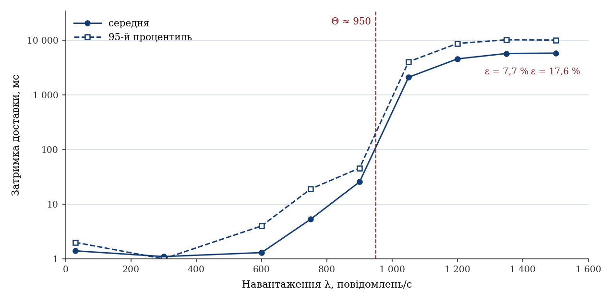

# Розгортання edge-cloud та дослідження масштабованості

## Складники

Систему поділено на периферійну та серверну частини у `smart/docker-compose.yml` із мережами `edge` та `cloud` і окремими томами даних:

### Периферійний складник

* **Брокер периферії (`edge-broker`):** локальний брокер Mosquitto 2 вузла `perim1` без відкритих портів (ліміти: 0.5 ядра, 128 МБ пам'яті).
* **Емулятор сенсорів (`sensors`):** імітує три датчики (`perim1-motion-1`, `perim1-light-1`, `perim1-gate-1`), публікує телеметрію (`QoS 0`) та збережені статуси (`QoS 1`, інтервал перевірки 3 с за FR-08). Лічильник запусків зберігається на окремому томі.
* **Периферійний шлюз (`gateway`):** єдиний міст між мережами `edge` та `cloud` (ліміти: 0.25 ядра, 128 МБ пам'яті). Записує покази в дисковий буфер SQLite (місткість 50 000 записів на окремому томі), передає їх із `QoS 1` та видаляє після `PUBACK`. Швидкість каналу обмежено до 1000 кбіт/с.

### Серверний складник

* **Серверний брокер (`cloud-broker`):** центральний брокер Mosquitto 2 з локальним портом 1883.
* **Серверний підписник (`collector`):** перевіряє формат повідомлень, відсікає дублікати та записує дані в базу SQLite на серверному томі.

## Розрив зв'язку

Для перевірки роботи системи під час збою мережі (сценарій QS-02) частоту сенсорів підвищено до 100 Гц на датчик ($\lambda = 300$ повідомлень/с), а шлюз відключено від серверної мережі на 60 с.

| Показник                                                   |   Значення   | Примітка                                                                   |
| :----------------------------------------------------------------- | :-------------------: | :--------------------------------------------------------------------------------- |
| Фіксація обриву шлюзом                         |        ~12 с        | `12:12:08Z` $\rightarrow$ `12:12:19.51Z` (інтервал Keep Alive 10 с) |
| Пікова черга у буфері $Q_0$                    |        18 455        | `12:13:09.58Z`, без відкинутих записів                       |
| Час вивантаження черги $T_{\text{розв}}$ |        ~31 с        | `12:13:09.58Z` $\rightarrow$ `12:13:40.69Z` (розрахунок: 28.0 с)  |
| Надіслано / отримано (запуск 2)             |    36 708 / 36 708    | Частка втрат $\varepsilon = 0.0$                                      |
| Виявлено дублікатів                              |          100          | Повторна передача пакетів без `PUBACK`                 |
| Затримка $L_{\text{д}}$ (сер. / p95 / макс.)     | 23.2 / 57.7 / 61.8 с | Відповідає тривалості 60-секундного розриву   |

### Оцінювання часу вивантаження буфера

$$
T_{\text{розв}} = \frac{Q_0}{\mu_1 - \lambda}
$$

* $Q_0 = 18\,455$ повідомлень – черга в буфері на момент відновлення зв'язку,
* $\mu_1 = 10^6 / (8 \cdot 130) \approx 960$ повідомлень/с – пропускна здатність каналу 1000 кбіт/с при розмірі повідомлення $s \approx 130$ байт,
* $\lambda = 300$ повідомлень/с – частота надходження нових повідомлень.

$$
T_{\text{розв}} = \frac{18\,455}{960 - 300} \approx 28.0 \text{ с}
$$

Розрахунок збігається з виміряними ~31 с (фактична швидкість становить $\mu_1 \approx 893$ повідомлень/с через заголовки MQTT/TCP та очікування `PUBACK`).

## Шаблони

### Публікація – підписка

* **Контекст:** Події периметра потрібні одночасно архіву та оператору, а стан датчиків треба знати без постійного опитування.
* **Задача:** Підключати нових споживачів телеметрії без змін у програмах сенсорів і підписника.
* **Сили:** Прямі з'єднання ускладнюють розширення системи, а часте опитування навантажує слабкий канал 1 Мбіт/с.
* **Розв'язок:** Ієрархічні теми MQTT `k1/perim1/<пристрій>/tele` (підписка `k1/+/+/tele`) та збережені статуси із заповітом `offline` у темах `.../state`.
* **Наслідки:** Підключення нових споживачів до серверного та периферійного брокерів одразу надало телеметрію і 3 статуси `online` без змін коду. Недолік – брокер не зберігає попередні повідомлення `QoS 0` для клієнтів, які підключилися пізніше.

### Буферизація на периферії

* **Контекст:** Вузол периметра працює через канал 1 Мбіт/с, де можливі перевантаження та обриви зв'язку (сценарій QS-02).
* **Задача:** Зберегти всі події під час розриву зв'язку тривалістю до 60 с без втрат ($\varepsilon = 0$, вимога 0% втрат для сигналів руху).
* **Сили:** Передача з `QoS 0` губить дані під час обриву, а буфер лише в оперативній пам'яті (128 МБ) переповнюється або очищається при збої.
* **Розв'язок:** Шлюз записує кожне повідомлення в дисковий буфер SQLite на 50 000 записів, надсилає їх із `QoS 1` і видаляє лише після отримання `PUBACK`.
* **Наслідки:** За штатного потоку 3 повідомлення/с буфера ($V_{\text{буф}} \approx 6.5$ МБ) вистачає на $\approx 4.6$ год автономної роботи; під час 60-секундного обриву при 300 повідомленнях/с втрати склали $\varepsilon = 0.0$. Плата за це – затримка доставки до 61.8 с на час обриву та 100 дублікатів `QoS 1`, які відсікає підписник за ключем показу (пристрій, запуск, порядковий номер).

## Навантаження

Межу насичення визначено ступінчастим тестом: частоту сенсорів вузла `perim1` підвищували від 10 до 500 Гц ($\lambda = 30 \dots 1500$ повідомлень/с) за місткості буфера 10 000 записів і смуги каналу 1000 кбіт/с.

| $\lambda$, повідомлень/с | $N_{\text{над}}$ | $N_{\text{отр}}$ | Частка втрат $\varepsilon$ | $L_{\text{д}}$ сер., мс | $p95$, мс | $\max$, мс | Завантаження $u = \lambda / \Theta$ |
| :------------------------------------: | :-------------------: | :-------------------: | :-------------------------------------: | :-----------------------------: | :-----------: | :------------: | :-----------------------------------------------: |
|                  30.0                  |          900          |          900          |                 0.0000                 |               1.4               |       2       |       3       |                       0.03                       |
|                 300.0                 |         9 000         |         9 000         |                 0.0000                 |               1.1               |       1       |       39       |                       0.32                       |
|                 600.0                 |        18 000        |        18 000        |                 0.0000                 |               1.3               |       4       |       47       |                       0.63                       |
|                 750.0                 |        22 500        |        22 500        |                 0.0000                 |               5.3               |      19      |       62       |                       0.79                       |
|                 900.0                 |        27 000        |        27 000        |                 0.0000                 |              25.7              |      46      |       62       |                       0.95                       |
|                 1050.0                 |        31 500        |        31 500        |                 0.0000                 |             2123.3             |     4077     |      4348      |                       1.11                       |
|                 1200.0                 |        36 000        |        36 000        |                 0.0000                 |             4609.7             |     8825     |      9336      |                       1.26                       |
|                 1350.0                 |        40 500        |        37 376        |                 0.0771                 |             5783.8             |     10297     |     11003     |                       1.42                       |
|                 1500.1                 |        45 000        |        37 088        |                 0.1758                 |             5863.8             |     10170     |     10988     |                       1.58                       |

* **Межа насичення ($\Theta \approx 950$ повідомлень/с):** До $u = 0.95$ затримка $p95$ не перевищує 46 мс без втрат. При $u > 1$ ($\lambda \ge 1050$ повідомлень/с) потік перевищує пропускну здатність каналу ($\mu_1 \approx 960$ повідомлень/с), у буфері росте черга, а $p95$ стрибає до 4.08–10.30 с ($10\,000 / 950 \approx 10.5$ с на вивантаження). На кроках 1350 і 1500.1 повідомлень/с буфер переповнюється, що дає втрати $\varepsilon = 0.0771$ (3124 відкинутих) та $\varepsilon = 0.1758$ (7912 відкинутих).
* **Вузьке місце:** За даними `docker stats` на піку 1350–1500 повідомлень/с споживання становить: шлюз – 14.81–15.96% процесора (60–64% квоти) і 25.27–27.28 МБ пам'яті зі 128 МБ, сенсори – 17.66–18.16% процесора і 16.39–16.83 МБ, підписник – 8.91–10.31% процесора і 24.44–24.94 МБ, брокери – 1.73–2.40% процесора і 3.99–4.67 МБ. Першим вузьким місцем є канал 1000 кбіт/с (у буфері шлюзу росте черга та відкидаються зайві записи), після розширення каналу наступним обмеженням стане ліміт процесора шлюзу (0.25 ядра).

## Масштабованість

* **Запас продуктивності:** Для вузла `perim1` (три сенсори з частотою 1–5 Гц, $\lambda = 3 \dots 15$ повідомлень/с) пропускна здатність $\Theta \approx 950$ повідомлень/с дає 63-кратний запас при 5 Гц та 317-кратний при 1 Гц. Штатна затримка 1.1–1.4 мс вкладається в мережевий бюджет $L_{\text{мер}} = 15$ мс (NFR-01) і забезпечує сповіщення швидше ніж за 1 с (FR-01).
* **Периферійний складник:** Насамперед варто розширити висхідний канал або фільтрувати на шлюзі незмінні стани руху й воріт. Нові ділянки периметра (`perim2`, `perim3`, до 16 вузлів за NFR-02) додаються горизонтально як окремі вузли, а зростання частоти на одному вузлі вирішується вертикально – збільшенням квоти процесора або перенесенням шлюзу на Go.
* **Серверний складник:** При збільшенні кількості вузлів підписник масштабується горизонтально через поділ підписки за темами ділянок (`k1/perim1/+/tele`, `k1/perim2/+/tele`), щоб зберегти перевірку послідовності номерів для кожного пристрою, а SQLite замінюється на серверне сховище часових рядів.

## Мова і стек

Вибір технологій для вузла `perim1` базується на вимогах предметної області та вимірюваннях `docker stats` на піковому навантаженні ($\lambda = 1350\text{--}1500$ повідомлень/с):

| Складник                     | Вимоги                                                                                      | Реалізація                       | Обґрунтування та альтернатива                                                                                                                                                                                                        |
| :----------------------------------- | :------------------------------------------------------------------------------------------------ | :----------------------------------------- | :-------------------------------------------------------------------------------------------------------------------------------------------------------------------------------------------------------------------------------------------------------------- |
| Сенсори                       | Сотні кілобайтів ОЗП, мале енергоспоживання                 | Python (`paho-mqtt`) – емулятор | Для стенда достатньо Python (16.4–16.8 МіБ ОЗП). На реальних мікроконтролерах потрібен C або Rust без збирача сміття.                                                             |
| Брокер периферії      | Мала пам'ять, автономність, підтримка QoS 1 і заповітів  | Eclipse Mosquitto 2.1 (C)                  | Споживає 4.0–4.7 МіБ ОЗП і до 2.1% CPU. Міст Mosquitto міг би замінити шлюз, але не керує витісненням черги.                                                                                   |
| Шлюз                             | Стійкий дисковий буфер, робота в межах `cpus: 0.25` і `128m` | Python, `paho-mqtt`, SQLite (`WAL`)    | Витрачає 25.3–27.3 МіБ ОЗП і 14.8–16.0% CPU, забезпечуючи $\Theta \approx 950$ повідомлень/с. Для десятків вузлів на одному пристрої альтернативою є Go.              |
| Серверний брокер      | Багато вузлів периметра та незалежних підписників     | Eclipse Mosquitto 2.1 (C)                  | Споживає 4.0–4.3 МіБ ОЗП і до 2.4% CPU. Брокер не зберігає історії потоків, тому для великих об'єктів альтернативою є Apache Kafka.                                          |
| Підписник і сховище | Перевірка схеми, ідемпотентний запис без дублікатів  | Python, `paho-mqtt`, SQLite (`WAL`)    | Витрачає 24.4–24.9 МіБ ОЗП і 8.9–10.3% CPU; одного файлу БД досить для ділянки. Для мережі периметрів потрібні кілька підписників за темами та TimescaleDB. |
